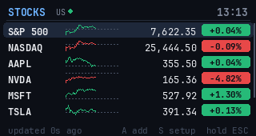
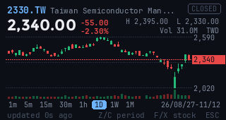
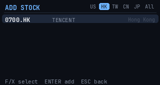
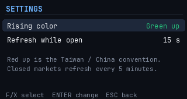

# Stocks for CardputerZero

A live stock watchlist and K-line (candlestick) charts on the M5Stack CardputerZero's 320x170 screen. US stocks by default; add Hong Kong, Taiwan, China and Japan stocks, indices, ETFs or crypto. Data comes from Yahoo Finance (no API key needed).

 

- **Watchlist**: price, the day's change and an intraday sparkline for each stock; a dot per market shows whether it is open.
- **K-line**: candlesticks with volume, day high/low and market state. The candle period is 1m, 5m, 15m, 30m, 1h, 1D, 1W or 1M (switch with Z/C; the choice is remembered).
- **Add**: pick a market (US / HK / TW / CN / JP / All) and type a name or code, e.g. `apple`, `700`, `2330`, `^HSI`, `BTC-USD`.
- **Settings**: rising color green (US convention) or red (Taiwan/China), and the refresh interval while a market is open (10-60 s; closed markets refresh every 5 minutes).

 

## Keys

| Screen | Key | Action |
|--------|-----|--------|
| Watchlist | F / X | Move up / down |
| Watchlist | Shift+F / Shift+X | Move the stock up / down |
| Watchlist | ENTER | K-line chart |
| Watchlist | A | Add a stock |
| Watchlist | DEL | Remove the stock (ENTER confirms) |
| Watchlist | S / R | Settings / refresh now |
| Watchlist | Hold ESC 3 s | Exit (a bar shows the countdown; let go to cancel) |
| K-line | Z / C | Shorter / longer candle period |
| K-line | F / X | Previous / next stock |
| K-line | ESC | Back |
| Add | TAB | Next market |
| Add | ENTER | Search, then add the selected result |

## Install

Build the package on the device:

```sh
sh build-deb.sh "Your Name <you@example.com>"
sudo dpkg -i zero-stocks_1.0.0_all.deb
```

For development, copy this folder to `~/zero-stocks` on the device and run `sudo sh ~/zero-stocks/install.sh` to register it with the launcher.

Requires `python3`, `python3-pil` and `python3-numpy`.

## Development

```sh
python3 -m unittest test_zero_stocks
python3 zero_stocks.py --fetch                                # print the watchlist
python3 zero_stocks.py --preview out.png                      # render the watchlist
python3 zero_stocks.py --preview out.png --detail 0700.HK --interval 1D
```

The watchlist and settings are stored in `~/.config/zero-stocks.json`; the last quotes are cached in `~/.local/share/zero-stocks/quotes.json`.

Quotes are delayed per exchange rules (US real time; Hong Kong and Taiwan about 15-20 minutes). Not investment advice.

## License

MIT
